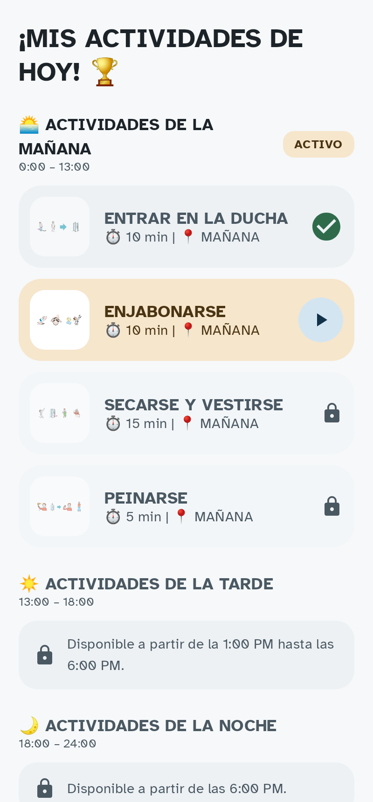
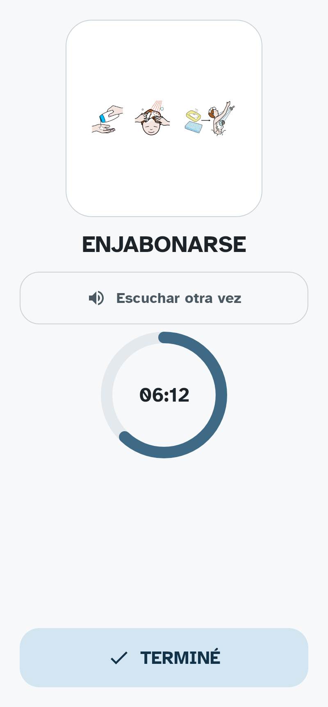
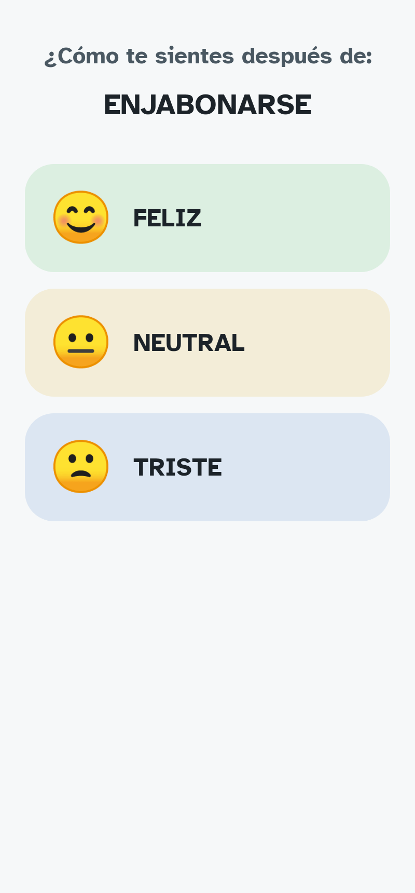
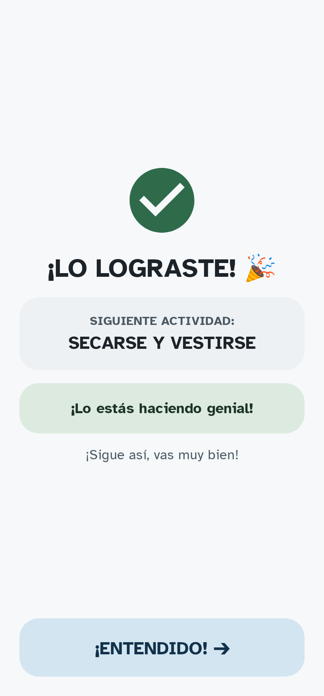
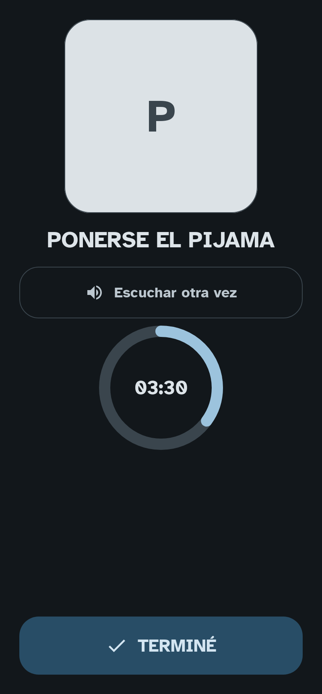
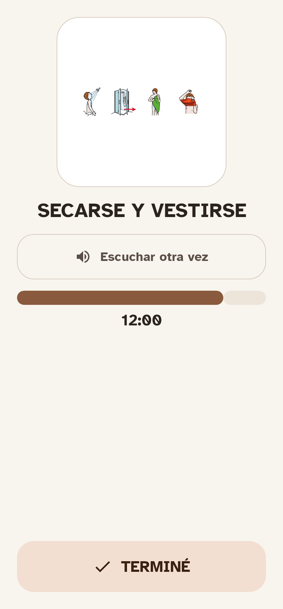
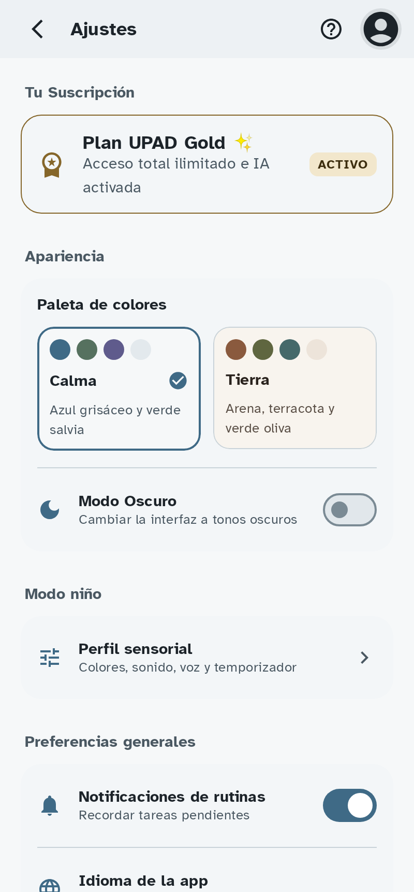
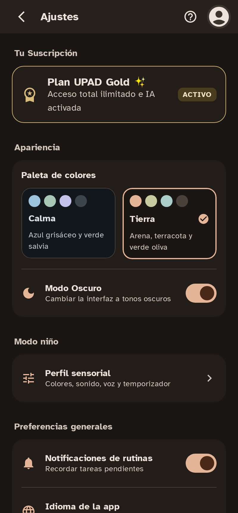
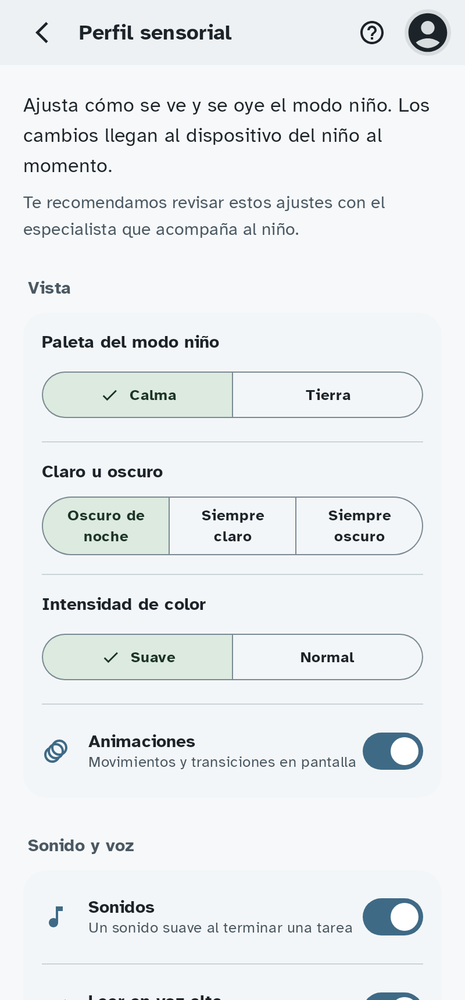

# U-Pad

[](https://github.com/iTovarr/U-PAD/actions/workflows/android.yml)


[](LICENSE)

**Agendas visuales, rutinas guiadas y seguimiento en tiempo real para niños con Trastorno del Espectro Autista (TEA).**

U-Pad es una aplicación Android nativa que ayuda a niños con TEA a ganar autonomía en su día a día mediante rutinas basadas en pictogramas. El tutor diseña las rutinas desde su dispositivo, el niño las sigue paso a paso en el suyo y el tutor ve su progreso al instante. Un asistente de inteligencia artificial propone actividades y mensajes de refuerzo adaptados a cada niño.

## Funcionalidades

**Para el tutor**

- Rutinas por turno (mañana, tarde y noche) y por día de la semana, con pictogramas de ARASAAC o fotos propias.
- Vinculación del dispositivo del niño mediante un código de 6 dígitos con caducidad.
- Progreso y registro emocional del día, calendario y avisos en tiempo real, también con la app cerrada.
- Asistente de IA: sugerencias de actividades, rutinas a medida con mensajes de refuerzo y análisis del día.
- Localización del dispositivo del niño en el mapa y bloqueo remoto confirmado con huella digital (plan Premium).
- Widgets de escritorio con el progreso del día.

**Para el niño**

- Agenda visual del día, sin necesidad de cuenta ni de escribir.
- Ejecución guiada de cada tarea y registro de cómo se sintió al terminarla.
- Mensajes de refuerzo positivo al completar la rutina.

La aplicación está disponible en español, inglés, francés, alemán, portugués y ruso.

## Capturas

**Modo niño**: pictogramas grandes, un solo botón fijo abajo y colores suaves. El tutor ajusta la paleta, el modo claro u oscuro, el temporizador, la voz y las celebraciones desde el perfil sensorial.

| Inicio del día | Tarea en curso | ¿Cómo te sientes? |
|:---:|:---:|:---:|
|  |  |  |

| Rutina completada | Noche, modo oscuro | Paleta Tierra |
|:---:|:---:|:---:|
|  |  |  |

**Panel del tutor**

| Ajustes (Calma, claro) | Ajustes (Tierra, oscuro) | Perfil sensorial |
|:---:|:---:|:---:|
|  |  |  |

Las capturas se generan con Robolectric a partir del código (`./gradlew :app:testDebugUnitTest --tests 'com.example.upad.capturas.CapturasTest'`), así que se pueden actualizar tras cada cambio de diseño.

[Ver la demostración en vídeo](https://youtu.be/fVQU3RGt8KI)

## Tecnologías

| Área | Tecnología |
|---|---|
| Lenguaje e interfaz | Kotlin, Jetpack Compose y Material 3 |
| Arquitectura | ViewModels, repositorios e inyección de dependencias manual |
| Backend | Firebase Authentication, Cloud Firestore, Cloud Storage y Cloud Messaging |
| Funciones en la nube | Cloud Functions para Firebase (Node.js 22) |
| Pictogramas | API de ARASAAC con Retrofit y Coil |
| Inteligencia artificial | Groq (`llama-3.3-70b-versatile`) con OkHttp |
| Ubicación y mapas | Fused Location Provider y Maps Compose |
| Persistencia local | Preferences DataStore |
| Calidad | JUnit, Android Lint y GitHub Actions |

## Arquitectura

```
Interfaz (Compose)  →  ViewModels  →  Repositorios  →  Firebase · ARASAAC · Groq
```

Las pantallas no acceden directamente a Firebase: trabajan con ViewModels, que a su vez usan repositorios. Las dependencias se crean en un único contenedor (`AppContainer`) y se inyectan por constructor.

El detalle de los paquetes, el modelo de datos en Firestore y los flujos principales (vinculación, tareas completadas, rastreo e IA) está en [docs/ARQUITECTURA.md](docs/ARQUITECTURA.md).

## Puesta en marcha

### Requisitos

- Android Studio con el SDK de Android 37.
- JDK 17 o superior para ejecutar Gradle (el propio Gradle descarga el JDK 21 que usa para compilar).
- Un proyecto de Firebase con Authentication (correo y Google), Firestore y Storage habilitados.
- Un dispositivo o emulador con Android 7.0 (API 24) o superior.

### Configuración

1. Copia `local.properties.example` como `local.properties` y completa las claves:

   ```properties
   GOOGLE_CLIENT_ID=tu_client_id_de_google_sign_in
   MAPS_API_KEY=tu_clave_del_sdk_de_google_maps

   # Recomendado: proxy de IA (la clave de Groq se queda en el servidor)
   AI_PROXY_URL=https://us-central1-TU_PROYECTO.cloudfunctions.net/aiChat

   # Solo para desarrollo, si aún no has desplegado el proxy.
   # Esta clave queda dentro del APK y puede extraerse.
   GROQ_API_KEY=
   ```

2. Descarga `google-services.json` desde la consola de Firebase y colócalo en `app/`.

Ninguno de los dos archivos se versiona.

### Ejecución

Abre el proyecto en Android Studio, sincroniza Gradle y ejecuta la configuración `app`. Desde la terminal:

```bash
./gradlew installDebug
```

### Servicios de Firebase

El repositorio incluye las reglas de seguridad de Firestore y Storage y dos Cloud Functions:

- `aiChat`: proxy de IA que evita incluir la clave de Groq en la aplicación. Solo atiende a tutores con sesión iniciada.
- `notifyParent`: envía una notificación push al tutor cuando el niño completa una actividad.

Se despliegan con [Firebase CLI](https://firebase.google.com/docs/cli). Las funciones requieren el plan Blaze.

```bash
firebase use TU_PROYECTO
firebase deploy --only firestore:rules,storage

cd functions && npm install && cd ..
firebase functions:secrets:set GROQ_API_KEY
firebase deploy --only functions
```

## Calidad

```bash
./gradlew testDebugUnitTest lintDebug
```

Cada push a `main` y cada pull request ejecutan en GitHub Actions los tests unitarios, Android Lint y la compilación del APK de debug.

## Build de release

```bash
./gradlew assembleRelease
```

El build de release se reduce y ofusca con R8. Para firmarlo, copia `keystore.properties.example` como `keystore.properties` y completa los datos de tu keystore; sin ese archivo se genera un APK sin firmar.

## Limitaciones conocidas

- **Modo kiosco.** El bloqueo del dispositivo del niño usa la fijación de pantalla estándar de Android. Sin registrar la aplicación como *Device Owner*, el niño puede salir con el gesto de desanclar: es una ayuda para mantener el foco, no un bloqueo inviolable.
- **Rastreo en segundo plano.** Si el sistema detiene el servicio de ubicación (ahorro de batería o reinicio del dispositivo), no se reanuda hasta que se vuelve a abrir el modo niño.
- **Dispositivo del niño sin sesión.** El dispositivo del niño no inicia sesión en Firebase, por lo que sus datos se protegen impidiendo listados y validando las escrituras. Los detalles están en `firestore.rules`.
- **Funciones en la nube.** Sin desplegar las Cloud Functions, los avisos al tutor solo llegan con la aplicación abierta y la IA usa la clave incluida en el build.

## Documentación

| Documento | Contenido |
|---|---|
| [Arquitectura](docs/ARQUITECTURA.md) | Capas, paquetes, modelo de datos y flujos principales. |
| [Privacidad](docs/PRIVACIDAD.md) | Borrador de la política de privacidad: qué datos se tratan y con quién se comparten. |
| [Licencias de terceros](docs/LICENCIAS_DE_TERCEROS.md) | Pictogramas, servicios externos y librerías. |
| [Guía de contribución](CONTRIBUTING.md) | Entorno, convenciones de código y de commits. |

## Licencia

El código se distribuye bajo la [licencia MIT](LICENSE). La licencia cubre el código del proyecto, no los pictogramas ni los servicios de terceros, que conservan las suyas.

Los símbolos pictográficos utilizados son propiedad del Gobierno de Aragón y han sido creados por Sergio Palao para [ARASAAC](https://arasaac.org), que los distribuye bajo Licencia Creative Commons BY-NC-SA. Esa licencia no permite el uso comercial; las implicaciones para el plan Premium se explican en [Licencias de terceros](docs/LICENCIAS_DE_TERCEROS.md).
